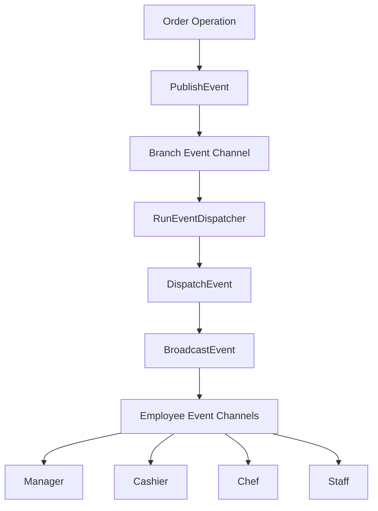

# Restaurant Order Management System

<p align="center">
  
  
  
  
</p>

A concurrency-focused, in-memory order management system for multi-branch restaurant operations, built with Go.

The system models order workflows, employee management, branch operations, and real-time event distribution. Its primary engineering focus is safe concurrent access to shared state, predictable event delivery, employee transfers between branches, and graceful application shutdown.

## Key Features

- **Multi-Branch Management** — Create and manage independent restaurant branches.
- **Employee Management** — Register employees with different roles: `manager`, `cashier`, `chef`, and `staff`.
- **Order Lifecycle Management** — Create, retrieve, and update orders while enforcing valid status transitions.
- **Event-Driven Communication** — Publish order events and distribute them to employees through branch-level event dispatchers.
- **Employee Branch Transfers** — Move employees between branches with clearly defined event-delivery semantics.
- **Graceful Shutdown** — Stop background dispatchers through context cancellation and wait for their completion.
- **Concurrency Safety** — Protect shared state with mutexes, atomic operations, and consistent lock ordering.
- **Race Detection** — Include tests designed to exercise concurrent operations and detect data races.

## Technology Stack

| Technology | Purpose |
|---|---|
| Go | Main programming language |
| Goroutines | Concurrent background processing |
| Channels | Event communication and distribution |
| `sync.Mutex` / `sync.RWMutex` | Shared-state synchronization |
| `sync.WaitGroup` | Background goroutine lifecycle management |
| `sync.Once` | Safe one-time shutdown |
| `sync/atomic` | Thread-safe event-drop statistics |
| `context.Context` | Cancellation and graceful shutdown |
| Go Race Detector | Detecting data races during testing |

## Architecture

The application follows a layered structure that separates domain models from business operations and event processing.

### Event Processing Flow



Event processing is divided into distinct responsibilities:

1. **Publish** — `PublishEvent` places an event on the branch event channel.
2. **Dispatch** — `RunEventDispatcher` continuously consumes events from that channel.
3. **Route** — `DispatchEvent` determines how an event should be distributed.
4. **Broadcast** — `BroadcastEvent` delivers events to employees currently assigned to the branch.

This separation keeps event production independent from event delivery and makes the system easier to extend with future routing strategies, such as role-based event distribution.

## Order Lifecycle

Orders follow an explicit state machine:

```text
pending ──────> preparing ──────> ready ──────> delivered
   │                │
   └──> cancelled   └──> cancelled
```

Valid transitions:

| Current Status | Allowed Next Status |
|---|---|
| `pending` | `preparing`, `cancelled` |
| `preparing` | `ready`, `cancelled` |
| `ready` | `delivered` |
| `delivered` | None |
| `cancelled` | None |

Invalid transitions are rejected by the domain model rather than being scattered throughout service operations.

## Concurrency and Data-Race Prevention

Concurrency safety is a core design principle of this project.

Shared state is protected at clearly defined synchronization boundaries. Operations involving multiple resources follow consistent locking rules to avoid race conditions and deadlocks.

### Synchronization Boundaries

Different components own and protect their own mutable state.

| Component | Synchronization Mechanism | Protected State |
|---|---|---|
| `OrderSystem` | `sync.RWMutex` | Branch, employee, and order-index maps; system lifecycle |
| `Branch` | `sync.RWMutex` | Employee membership and branch orders |
| `Employee` | `sync.Mutex` | Current branch reference |
| Order operations | Branch write lock | Order status and stored order data |
| Event statistics | `sync/atomic` | Dropped-event counter |
| Dispatcher lifecycle | `sync.WaitGroup` | Background goroutine tracking |

### Lock Ordering and Employee Transfers

An employee transfer modifies multiple related pieces of state:

- The employee's current branch.
- The old branch's employee membership.
- The new branch's employee membership.

To prevent inconsistent state and lock-order deadlocks, the transfer operation follows a defined locking sequence:

1. Acquire the system read lock for the duration of the transfer, preventing shutdown from completing midway through the operation.
2. Lock the employee before modifying its branch assignment.
3. Acquire both branch locks in sorted branch-ID order.
4. Remove the employee from the old branch.
5. Add the employee to the new branch.
6. Update the employee's current branch reference.
7. Release the locks.

Using a consistent branch-locking order ensures that concurrent transfers cannot deadlock by acquiring the same branch locks in opposite orders.

### Safe Event Broadcasting

Broadcasting uses a branch read lock while performing short, non-blocking sends to employee channels.

This provides an important guarantee:

- A transfer waits for any broadcast already in progress.
- Once the transfer completes, subsequent broadcasts from the old branch no longer include that employee.
- Subsequent broadcasts from the new branch can include the employee.

This behavior ensures that branch membership and event delivery remain consistent during transfers.

### Channel Ownership and Graceful Shutdown

Channel ownership is designed to prevent unsafe concurrent operations.

- Employee event channels are exposed as receive-only channels.
- Consumers cannot send to or close employee channels through the public API.
- Event channels are not closed during shutdown.
- Context cancellation signals dispatcher goroutines to stop.
- A `sync.WaitGroup` tracks dispatcher goroutines until completion.
- Dispatcher registration and shutdown synchronization prevent a `WaitGroup.Add` / `Wait` race.

Using context cancellation instead of closing shared channels avoids potential sends to closed channels during shutdown.

### Backpressure Policy

Employee event channels have bounded buffers.

Broadcast operations use non-blocking sends. If an employee's event buffer is full, the event delivery is dropped and the branch's dropped-event counter is incremented.

This prevents a slow consumer from blocking the branch dispatcher and delaying other employees.

This is an intentional trade-off: the current implementation prioritizes non-blocking event distribution over guaranteed delivery.

A production-grade implementation may require persistent queues, acknowledgements, retry mechanisms, or a dedicated message broker.

### Employee Transfer Semantics

The transfer operation guarantees that future broadcasts from the previous branch will no longer include the transferred employee.

However, events already queued in the employee's channel are not drained or removed.

Therefore:

- Events queued before a transfer may still be received after the transfer.
- New events broadcast by the previous branch after the transfer completes will not be delivered to that employee.
- New events broadcast by the new branch can be delivered normally.

This behavior is deliberate and keeps event-delivery semantics explicit.

## Project Structure

```text
.
├── cmd/
│   └── demo/
│       └── main.go
│
├── internal/
│   ├── model/
│   │   ├── employee.go
│   │   ├── event.go
│   │   ├── order.go
│   │   ├── role.go
│   │   └── order_test.go
│   │
│   └── service/
│       ├── branch.go
│       ├── employee.go
│       ├── errors.go
│       ├── system.go
│       └── system_test.go
│
├── go.mod
└── README.md
```

### Package Responsibilities

- `internal/model` — Domain entities, employee roles, order statuses, event definitions, and lifecycle validation.
- `internal/service` — Branch management, employee management, order operations, event distribution, and application lifecycle.
- `cmd/demo` — Runnable example demonstrating multi-branch operations and event delivery.

## Requirements

- Go 1.22 or newer

## Getting Started

Clone the repository:

```bash
git clone https://github.com/yasmansh/restaurant-order-management.git
cd restaurant-order-management
```

Run the demonstration:

```bash
go run ./cmd/demo
```

## Testing and Code Quality

Run all tests:

```bash
go test ./...
```

Run tests with the Go race detector:

```bash
go test -race ./...
```

Run static analysis:

```bash
go vet ./...
```

The race detector is particularly important for this project because several operations involve concurrent access to shared maps, employee state, branch membership, and event channels.

## Scope and Limitations

This project is an in-memory application focused on domain modeling, event-driven communication, and Go concurrency patterns.

It currently does not include:

- Persistent database storage.
- HTTP or RPC APIs.
- Authentication and authorization.
- Distributed deployment.
- Guaranteed event delivery.
- Persistent event queues.

All branches, employees, orders, and queued events are lost when the application exits.

The event-processing pipeline operates within a single process and is not intended to replace a durable message broker.

## Future Improvements

Potential extensions include:

- Role-based event routing and authorization.
- Persistent storage for orders and branch information.
- HTTP API for order and employee operations.
- Event acknowledgements, retries, and dead-letter handling.
- Integration tests under higher event-processing loads.
- Metrics and observability for event throughput and delivery failures.

## Author

**Yasaman Sheikhan**

- GitHub: [@yasmansh](https://github.com/yasmansh)

Feel free to explore the code, open issues, or suggest improvements.

## License

No license has been added yet. A `LICENSE` file should be added before distributing this project as open-source software.